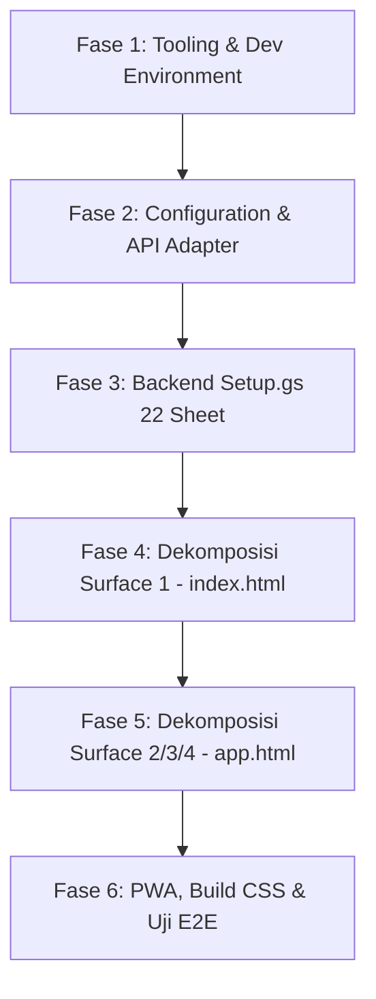

# SDW UMROH — RENCANA IMPLEMENTASI TERPERINCI (STEP-BY-STEP EXECUTION PLAN)
**Strategi:** Amati — Tiru — Modifikasi (ATM) dari Mubarokah_App  
**Versi:** 1.0.0  
**Tanggal:** 26 Oktober 2026  
**Status:** DRAFT / PROPOSED  
**Dokumen Pendahulu:** `docs/00` s/d `docs/22` (PRD, Blueprints, Security, UI/UX, Database Spec 22 Sheet, Audit & Benchmark)

---

## 1. RINGKASAN TUJUAN & TARGET ARSITEKTUR

Tujuan rencana implementasi ini adalah mentransformasi prototipe monolitik SDW UMROH (`sdw_umroh_prototype_foundation.html`) menjadi aplikasi modular, tangguh, berkinerja tinggi, dan siap produksi (*production-grade*) dengan mereplikasi arsitektur teruji **Mubarokah_App** yang disesuaikan (*customized*) untuk kebutuhan ekosistem Tour & Travel Umroh.

### Target Struktur Repositori (Post-Implementation File Tree)

```text
SDW_UMROH/
├── .clasp.json                           # Konfigurasi sinkronisasi Google Apps Script CLI
├── .gitignore                            # Mengabaikan node_modules, build cache, dan credentials
├── package.json                          # Dependensi tooling & skrip build (Tailwind, local server)
├── package-lock.json
├── server.js                             # Zero-dependency local Node.js development server
├── vercel.json                           # Konfigurasi routing rewrite & clean URLs untuk production Vercel
├── tailwind.config.js                    # Konfigurasi token desain (Pine Green, Warm Gold, Sand, Font Arab)
│
├── css/
│   ├── input.css                         # Sumber Tailwind directives, custom font rules, & utility classes
│   └── styles.min.css                    # Hasil build terkompresi (tanpa CDN runtime)
│
├── assets/                               # Media, ikon, logo resmi, dan ilustrasi
│   ├── img/                              # Foto hero Ka'bah, galeri destinasi, placeholder paket
│   └── icons/                            # PWA app icons (192x192, 512x512, maskable)
│
├── manifest.json                         # Web App Manifest untuk PWA installability
├── sw.js                                 # Service Worker untuk caching offline & asset pre-caching
│
├── index.html                            # SURFACE 1: Public Website & Package Catalog (Landing Page)
├── app.html                              # SURFACE 2, 3, 4: Jamaah PWA & Backoffice Enterprise App
│
├── js/                                   # Modul JavaScript Klien (Decoupled Vanilla Modules)
│   ├── app-config.js                     # Single Source of Truth: Tenant, Brand, Endpoints, Storage Keys
│   ├── api.js                            # GAS API Adapter (Non-preflight POST, caching, error boundaries)
│   ├── auth.js                           # Session management, JWT decoding, role switching
│   ├── pwa.js                            # PWA install prompt handler, standalone detection, update worker
│   ├── catalog.js                        # Filter paket, render kartu dinamis, modal detail paket
│   ├── departures.js                     # Jadwal keberangkatan, status sisa kursi, filter kloter
│   ├── estimator.js                      # Kalkulator estimasi biaya keluarga terpadu & simulasi DP
│   ├── jamaah.js                         # Surface 2: Profil jamaah, berkas paspor/visa, invoice, checklist
│   ├── crm.js                            # Surface 4: CRM Leads pipeline, aktivitas sales, follow-up
│   ├── finance.js                        # Surface 4: Verifikasi pembayaran, jadwal termin, refund audit
│   └── operations.js                     # Surface 4: Manifest kloter, pembagian kamar, manasik, TL/Muthawwif
│
├── backend/                              # Google Apps Script Source Code
│   ├── appsscript.json                   # Manifest Apps Script (Timezone, runtime V8, web app config)
│   ├── Setup.gs                          # 2-Phase Fail-Closed Schema Initializer (22 Sheet & RBAC check)
│   └── Code.gs                           # Web App API Controller (doGet, doPost, Auth, CRUD, Audit Trail)
│
└── docs/                                 # Dokumentasi Arsitektur & Spesifikasi Kanonikal (00 - 23)
```

---

## 2. DAFTAR DEPENDENSI & PRASYARAT LINGKUNGAN

### Dependensi Pengembangan (Dev Dependencies)
Tidak memerlukan framework JavaScript berat (React/Vue/Next.js) pada tahap ini agar kompatibel penuh dengan arsitektur ringan Mubarokah:
- `tailwindcss` (`^3.4.19`): Compiler CSS utilitas lokal.
- `@google/clasp` (`^2.4.2` - opsional global/dev): CLI untuk sinkronisasi kode ke Google Apps Script.

### Dependensi Runtime
- **Frontend:** Zero runtime dependency (Native ES6+ Vanilla JS).
- **Backend:** Google Apps Script Runtime V8.
- **Database:** Google Spreadsheet (22 Sheet terkelola).
- **Hosting:** Vercel (Statis + Edge routing) & local Node.js engine (`node server.js`).

---

## 3. URUTAN EKSEKUSI TAHAP DEMI TAHAP (STEP-BY-STEP WORKFLOW)

Eksekusi dibagi menjadi **6 Fase Berurutan** dengan gerbang verifikasi (*acceptance criteria*) di setiap akhir fase:



---

### FASE 1: TOOLING & DEV ENVIRONMENT SETUP
**Fokus:** Menyiapkan otomasi lokal, dev server, dan pipeline kompilasi CSS agar lepas dari ketergantungan CDN.

1. **Langkah 1.1 — Pembuatan `package.json`**
   - Mendefinisikan metadata proyek `sdw-umroh-app`.
   - Menambahkan skrip NPM:
     ```json
     {
       "scripts": {
         "dev": "node server.js",
         "start": "node server.js",
         "build:css": "tailwindcss -i ./css/input.css -o ./css/styles.min.css --minify",
         "watch:css": "tailwindcss -i ./css/input.css -o ./css/styles.min.css --watch",
         "build": "npm run build:css",
         "backend:push": "cd backend && clasp push -f",
         "backend:pull": "cd backend && clasp pull"
       }
     }
     ```
2. **Langkah 1.2 — Konfigurasi `tailwind.config.js`**
   - Menetapkan palet warna resmi SDW UMROH (`08_UI_UX_DESIGN_SYSTEM.md`):
     - `pine`: `#0F4C3A` (primer), `#093327` (dark)
     - `gold`: `#D4AF37` (aksen), `#F5E8C7` (light)
     - `sand`: `#F9F6F0` (latar lembut), `#EFE8DC` (border/divider)
   - Konfigurasi font: `Plus Jakarta Sans` dan `Amiri`.
3. **Langkah 1.3 — Pembuatan `css/input.css`**
   - Memuat direktif `@tailwind base;`, `@tailwind components;`, `@tailwind utilities;`.
   - Mengatur utilitas kustom: `.no-scrollbar`, animasi yang patuh `prefers-reduced-motion`, dan styling khusus cetak/invoice.
4. **Langkah 1.4 — Pembuatan `server.js` (Local Development Server)**
   - Meniru implementasi [Mubarokah server.js](file:///c:/Users/pc/Documents/APP/Mubarokah_App/server.js).
   - Menyediakan server statis HTTP lokal (port 3000) dengan *clean routing*:
     - Request `/` atau kosong -> melayani `/index.html`.
     - Request `/app`, `/admin`, `/jamaah` -> melayani `/app.html`.
     - Dukungan MIME types lengkap untuk font, webp, dan json.
5. **Langkah 1.5 — Pembuatan `vercel.json`**
   - Meniru konfigurasi [Mubarokah vercel.json](file:///c:/Users/pc/Documents/APP/Mubarokah_App/vercel.json) untuk rewriting path saat di-deploy ke produksi.

*Kriteria Keberhasilan Fase 1:*
`npm install` berjalan lancar, `npm run build:css` menghasilkan `css/styles.min.css`, dan `npm run dev` dapat membuka server lokal di browser.

---

### FASE 2: CONFIGURATION CONTRACT & CLIENT API ADAPTER
**Fokus:** Membangun *single source of truth* konfigurasi klien dan lapisan komunikasi jaringan yang kebal CORS.

1. **Langkah 2.1 — Pembuatan `js/app-config.js`**
   - Meniru pola `APP_CONFIG` Mubarokah dengan `Object.freeze`:
     - **Tenant Identity:** Nama travel ("SDW UMROH"), nomor izin PPIU placeholder, kontak WhatsApp resmi, alamat kantor pusat.
     - **Branding:** Warna tema, tagline ("One Journey, One Platform").
     - **Infrastructure:** Pointers URL Google Apps Script Web App.
     - **Storage Namespace:** Kunci penyimpanan terisolasi:
       - `sdw_admin_token`, `sdw_admin_role`, `sdw_jamaah_token`, `sdw_jamaah_data`, `sdw_theme`, `sdw_cart_estimate`.
2. **Langkah 2.2 — Pembuatan `js/api.js` (Non-Preflight GAS Adapter)**
   - Fungsi `apiGet(action, params)`: Mengirim request GET dengan `redirect: "follow"` dan `credentials: "omit"`.
   - Fungsi `apiPost(action, payload)`:
     - Menggunakan `Content-Type: text/plain;charset=utf-8` agar tidak memicu browser preflight OPTIONS.
     - Otomatis menyematkan token autentikasi aktif dari `sessionStorage`/`localStorage`.
     - Mengembalikan data dengan standarisasi envelope `{ success: true, data: ..., error: null }`.
   - Fallback offline cache jika koneksi internet terputus di tanah suci.

*Kriteria Keberhasilan Fase 2:*
`APP_CONFIG` dapat diakses global di browser console, dan `api.js` siap menerima request tanpa melempar error sintaks.

---

### FASE 3: GOOGLE APPS SCRIPT DATABASE ENGINE (22 SHEET FAIL-CLOSED)
**Fokus:** Menyiapkan database Google Spreadsheet otomatis dan aman menggunakan pola [Setup.gs](file:///c:/Users/pc/Documents/APP/Mubarokah_App/legacy/Setup.gs) Mubarokah.

1. **Langkah 3.1 — Pembuatan `backend/Setup.gs`**
   - Mengambil definisi 22 Sheet dari [sdw_umroh_spreadsheet_schema.md](file:///c:/Users/pc/Documents/APP/SDW_UMROH/sdw_umroh_spreadsheet_schema.md):
     - `DB_Users`, `DB_Customers`, `DB_Leads`, `DB_Sales_Activities`, `DB_Follow_Ups`, `DB_Packages`, `DB_Package_Prices`, `DB_Departures`, `DB_Registrations`, `DB_Document_Requirements`, `DB_Pilgrim_Documents`, `DB_Invoices`, `DB_Payment_Schedules`, `DB_Payments`, `DB_Refunds`, `DB_Preparation`, `DB_Manasik`, `DB_Trips`, `DB_Trip_Members`, `DB_Announcements`, `DB_Notifications`, `DB_Audit_Logs`.
   - **Phase A (Inspect / Preflight):** Memeriksa keberadaan spreadsheet; jika ada data existing, memvalidasi integritas tanpa menghapus data (*zero data wipe*).
   - **Phase B (Execute):** Membuat sheet yang belum ada, menyuntikkan header kanonikal, membekukan baris pertama (*freeze header*), menerapkan warna branding Pine Green pada header, dan mengenerate secret tokens CSPRNG (`Utilities.getUuid()`).
2. **Langkah 3.2 — Pembuatan `backend/Code.gs`**
   - Mengintegrasikan draf backend [sdw_umroh_apps_script_backend.js](file:///c:/Users/pc/Documents/APP/SDW_UMROH/sdw_umroh_apps_script_backend.js).
   - Menambahkan router aksi:
     - **GET:** `getPackages`, `getDepartures`, `checkRegistration&regId=...`, `getAnnouncements`, `getJamaahProfile`.
     - **POST:** `submitLead`, `registerPilgrim`, `uploadDocumentRef`, `submitPayment`, `verifyPayment`, `verifyDocument`, `updateTripManifest`.
   - Menegakkan pencatatan mutasi pada `DB_Audit_Logs` secara append-only.

*Kriteria Keberhasilan Fase 3:*
Fungsi `initializeSdwUmrohInfrastructure()` pada `Setup.gs` sukses dijalankan di Apps Script editor dan menghasilkan 22 sheet lengkap dengan header yang presisi.

---

### FASE 4: DEKOMPOSISI SURFACE 1 — PUBLIC WEB PORTAL (`index.html`)
**Fokus:** Membangun landing page publik yang cepat, menarik, kaya fotografi, dan memiliki konversi tinggi tanpa polusi antarmuka prototipe.

1. **Langkah 4.1 — Pembuatan `index.html` Bersih**
   - Menghapus artefak prototipe (role selector, tombol simulasi internal, badge "Step 1A.1").
   - Menghubungkan CSS lokal `<link rel="stylesheet" href="css/styles.min.css">`.
   - Mengimplementasikan alur naratif 5W+1H yang diperkaya:
     - **Hero Section:** Foto Ka'bah berkualitas tinggi, Bismillah tipografi Arab, judul tegas, 1 CTA Primer (Konsultasi WA) + 1 CTA Sekunder (Lihat Paket).
     - **Trust Bar Resmi:** Slot izin PPIU Kemenag, logo mitra maskapai (Garuda, Saudia), stat kepuasan jamaah.
     - **Katalog Paket Dinamis:** Filter kategori (Reguler, VIP, Ramadhan), chip durasi hari, ★ rating paket, harga "Mulai dari Rp X", dan sisa kursi.
     - **Tabel Jadwal Keberangkatan:** Pengelompokan per bulan, maskapai, status kuota real-time dengan progress bar.
     - **Kalkulator Estimasi Biaya Keluarga:** Interaktif, transparan, memuat rincian DP dan pelunasan.
     - **Destinasi & Edukasi (Where & Why):** Galeri Makkah & Madinah, teaser artikel fiqih umroh.
     - **FAQ Interaktif:** Akordeon semantik native.
     - **Footer Publik Lengkap:** Legalitas, alamat kantor, Google Maps, tautan syarat & ketentuan.
2. **Langkah 4.2 — Pembuatan Modul JS Pendukung Portal Publik**
   - `js/catalog.js`: Mengontrol filter kategori, rendering kartu paket, dan modal detail paket komprehensif (Ringkasan, Itinerary Harian, Include/Exclude, Akomodasi).
   - `js/departures.js`: Rendering tabel jadwal keberangkatan terpadu.
   - `js/estimator.js`: Logika perhitungan kamar Quad/Triple/Double, diskon grup, simulasi cicilan/termin DP.
3. **Langkah 4.3 — Implementasi WhatsApp Deep-Link & Floating Button**
   - Tombol WhatsApp melayang (*sticky floating button*) di sudut kanan bawah.
   - Setiap kartu paket menghasilkan deep-link WA dengan pesan terisi otomatis (*prefilled text*).

*Kriteria Keberhasilan Fase 4:*
Landing page `index.html` dapat dimuat cepat, bebas dari error console, skor responsif mobile mulus, dan seluruh aksi klik paket terhubung ke modal detail atau WhatsApp resmi.

---

### FASE 5: DEKOMPOSISI SURFACE 2, 3, 4 — JAMAAH PWA & BACKOFFICE (`app.html`)
**Fokus:** Memisahkan aplikasi manajemen operasional dan portal pendamping jamaah ke dalam halaman mandiri yang aman.

1. **Langkah 5.1 — Pembuatan `app.html` (Application Shell)**
   - Mengadopsi struktur shell [Mubarokah app.html](file:///c:/Users/pc/Documents/APP/Mubarokah_App/app.html):
     - Sidebar navigasi desktop & Header bar dinamis dengan indikator sesi peran aktif.
     - Area konten dinamis (*tab switcher*) yang memuat container masing-masing modul.
     - Mobile Bottom Navigation khusus mode PWA di smartphone.
2. **Langkah 5.2 — Pembuatan `js/auth.js` & Kontrol Akses (RBAC)**
   - Login multi-role (Jamaah via No. Registrasi/WA, Staf/Admin via Email/Password atau Google Auth).
   - Mengisolasi antarmuka berdasarkan peran (12 Roles):
     - Peran `PILGRIM`: Hanya melihat Surface 2 (Profil, Dokumen, Invoice, Itinerary Kloter, Panduan Manasik).
     - Peran `SALES`: Melihat CRM Leads, aktivitas follow-up, komisi.
     - Peran `DOCUMENT_OFFICER`: Hanya melihat verifikasi paspor, visa, dan vaksin.
     - Peran `FINANCE`: Melihat invoice, termin, konfirmasi bukti transfer, rekonsiliasi refund.
     - Peran `OPERATIONS` / `TOUR_LEADER`: Melihat manifest bus, kamar hotel, dan check-in jamaah.
3. **Langkah 5.3 — Pembuatan Modul Operasional Spesifik**
   - `js/jamaah.js`: Manajemen berkas digital jamaah, barcode digital jamaah, dan tracking progres kesiapan keberangkatan.
   - `js/crm.js`: Pipeline leads visual (New, Contacted, Qualified, Converted, Lost).
   - `js/finance.js`: Verifikasi pembayaran 1-klik, cetak kuitansi PDF (*canvas/pdf-lib*), penguncian `agreed_price_snapshot`.
   - `js/operations.js`: Manifest kloter jamaah dan penugasan pembimbing ibadah.

*Kriteria Keberhasilan Fase 5:*
Aplikasi `app.html` dapat memproses login, merender dashboard sesuai peran, dan menjalankan siklus perubahan status data (misal: verifikasi pembayaran memperbarui status invoice).

---

### FASE 6: PWA CAPABILITIES, COMPILATION & VERIFIKASI AKHIR
**Fokus:** Mengaktifkan kapabilitas offline PWA, kompilasi aset akhir, dan audit performa.

1. **Langkah 6.1 — Konfigurasi PWA Standalone**
   - `manifest.json`: Warna tema `#0F4C3A`, nama "SDW Umroh", ikon resolusi 192px dan 512px.
   - `sw.js`: Pre-caching file inti (`index.html`, `app.html`, `styles.min.css`, JS modules, logo) agar dapat dibuka saat sinyal lemah di bandara/tanah suci.
   - `js/pwa.js`: Deteksi standalone mode (`display-mode: standalone`) untuk mengaktifkan antarmuka 3-mode Mubarokah.
2. **Langkah 6.2 — Final CSS Compilation & Asset Optimization**
   - Menjalankan `npm run build:css` untuk menghasilkan bundle produksi terkompresi.
   - Menghapus seluruh pemanggilan script eksternal yang tidak diperlukan.
3. **Langkah 6.3 — Pengujian & Audit Kepatuhan (Pre-Flight Checklist)**
   - Memastikan tidak ada *hardcoded credentials* atau kunci rahasia di frontend.
   - Memastikan penanganan error ramah pengguna pada form pendaftaran dan booking.
   - Memverifikasi audit aksesibilitas (kontras warna teks Pine/Gold memenuhi rasio WCAG AA).

---

## 4. MATRIKS RISIKO & STRATEGI MITIGASI

| Risiko Potensial | Dampak | Probabilitas | Strategi Mitigasi Terencana |
|---|---|---|---|
| **CORS Error pada Google Apps Script** | Request frontend diblokir oleh browser | Sedang | Menggunakan pola `Mubarokah api.js` (`Content-Type: text/plain` + redirect follow). |
| **Data Spreadsheet Tertimpa saat Setup** | Hilangnya data jamaah existing | Tinggi | Menerapkan `Setup.gs` Phase A (Read-only preflight); eksekusi berhenti otomatis jika sheet sudah berisi data. |
| **Koneksi Internet Lemah di Tanah Suci** | Aplikasi Jamaah PWA macet saat dipakai di Makkah/Madinah | Tinggi | PWA Service Worker caching (`sw.js`) dan penyimpanan profil/itinerary offline di `localStorage`. |
| **Perubahan Harga Katalog Mempengaruhi Jamaah Lama** | Sengketa finansial tagihan jamaah | Kritis | Mengunci `agreed_price_snapshot` saat pendaftaran disubmit (sesuai aturan bisnis kanonikal `06`). |

---

## 5. REKOMENDASI URUTAN KERJA BERIKUTNYA

Rencana implementasi di atas telah siap untuk dieksekusi secara bertahap. Rekomendasi urutan eksekusi teknis selanjutnya:

1. **Eksekusi Tahap 1:** Membangun pondasi lingkungan dev (`package.json`, `tailwind.config.js`, `css/input.css`, `server.js`, dan build CSS pertama).
2. **Eksekusi Tahap 2:** Membangun `js/app-config.js` dan `js/api.js`.
3. **Eksekusi Tahap 3:** Membangun `backend/Setup.gs` untuk inisialisasi 22 sheet Google Spreadsheet.
4. **Eksekusi Tahap 4:** Membangun `index.html` (Landing Page Publik) lengkap dengan modul katalog dan estimator.
5. **Eksekusi Tahap 5:** Membangun `app.html` (Jamaah PWA & Backoffice Portal) beserta modul otentikasi dan operasionalnya.
6. **Eksekusi Tahap 6:** PWA Service Worker dan final testing.
