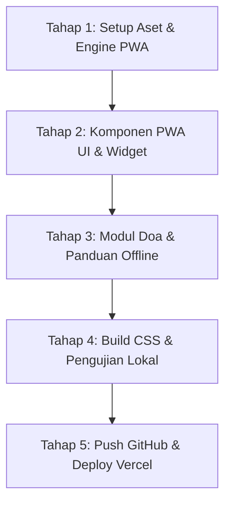

# Rencana Implementasi: Transformasi PWA Mobile SDW UMROH
**Referensi Desain & Arsitektur:** Aplikasi PPTQ Asnawiyyah & MTs YASUA (`asnawiyyah.or.id`)  
**Target Platform:** Mobile Web & PWA Standalone (Android & iOS) + Responsif Desktop  
**Tanggal:** 27 Oktober 2026  
**Status:** Siap Dieksekusi Menunggu Persetujuan  

---

## 1. Ringkasan Eksekutif & Tujuan

Mengadopsi pola sukses **Islamic Super-App Layout** dari aplikasi **Asnawiyyah** ke dalam **SDW UMROH** untuk menghadirkan pengalaman mobile yang cepat, nyaman, dan berkelas dunia (*native-app feel*).

### Nilai Tambah Utama:
1. **Pengalaman Dual-Mode:**
   - **Mode Web Profil (Desktop / Browser Luas):** Tampilan megah dengan Hero Ka'bah sinematik, komparasi paket lengkap, dan branding corporate travel umroh resmi.
   - **Mode App Dashboard (Mobile / PWA Standalone):** Tampilan ringkas, ramah jempol (*thumb-friendly*), hemat kuota, dan responsif layaknya aplikasi mobile buatan Play Store / App Store.
2. **Kesiapan Ibadah Offline di Tanah Suci:**
   - Dengan teknologi Service Worker (`sw.js`), panduan manasik, doa thawaf, doa sa'i, dan nomor darurat muthawwif tetap dapat dibuka jamaah saat berada di pelataran Masjidil Haram/Masjid Nabawi meskipun tanpa sinyal internet/roaming.
3. **Widget Waktu Sholat Haramain & Real-time Clock:**
   - Menampilkan waktu sholat Makkah & Madinah secara real-time, tanggal Hijriah resmi, dan countdown menuju sholat berikutnya.

---

## 2. Dekomposisi Komponen UI Mobile (Mengadopsi Asnawiyyah)

Berdasarkan telaah mendalam arsitektur visual Asnawiyyah, antarmuka mobile SDW UMROH akan dibagi menjadi 7 modul utama:

```
┌────────────────────────────────────────────────────────┐
│  [A] Top Islamic App Bar & Status Notifikasi          │
├────────────────────────────────────────────────────────┤
│  [B] Widget Waktu Sholat Haramain & Tanggal Hijriah    │
├────────────────────────────────────────────────────────┤
│  [C] Quick Action Grid (8 Ikon Layanan Umroh)          │
│      [Paket]  [Kloter]  [Kalkulator]  [Panduan Doa]   │
│      [Ziarah] [Syarat]  [Live Ka'bah] [CS Khidmat]    │
├────────────────────────────────────────────────────────┤
│  [D] Banner Promo & Edukasi Carousel (Auto-slide)      │
├────────────────────────────────────────────────────────┤
│  [E] Feed Rekomendasi: Paket Unggulan & Fiqih Ringkas │
├────────────────────────────────────────────────────────┤
│  [F] Floating Native Bottom Dock (5 Tab Menu)         │
│      [Beranda] [Paket] [Doa/Ibadah] [Kloter] [Jamaah] │
├────────────────────────────────────────────────────────┤
│  [G] Modal Pengaturan, Ukuran Teks & Panduan Install  │
└────────────────────────────────────────────────────────┘
```

### [A] Top Islamic App Bar
- Logo SDW UMROH + Tipografi "SDW UMROH — One Journey, One Platform".
- Status Lencana: *Penyelenggara Resmi Kemenag RI*.
- Ikon Aksi Cepat: Notifikasi Kloter & Tombol Hubungi Muthawwif/CS WhatsApp.

### [B] Widget Waktu Sholat Haramain & Tanggal Hijriah
- **Waktu Sholat Makkah & Madinah:** Subuh, Terbit, Zuhur, Ashar, Maghrib, Isya.
- **Indikator Sholat Berikutnya:** Menampilkan waktu sholat terdekat beserta hitung mundur (misal: *Zuhur Makkah 12:15 WAS*).
- **Kalender Ganda:** Tanggal Masehi dan Tanggal Hijriah (misal: *15 Jumadil Ula 1448 H*).
- **Jam Digital Real-time:** Menampilkan detak detik secara akurat.

### [C] Quick Action Grid (8 Ikon Layanan Utama)
Grid 4 kolom x 2 baris dengan ikon *squircle* berbayang lembut dan warna tematik:
1. 🕋 **Paket Umroh:** Akses langsung ke katalog Paket Reguler, VIP Khidmat, dan Ramadhan.
2. 📅 **Jadwal Kloter:** Cek sisa kuota kursi, jadwal manasik, dan tanggal penerbangan langsung.
3. 🧮 **Kalkulator Biaya:** Simulasi upgrade kamar (Quad/Triple/Double) & tabungan syariah.
4. 📖 **Panduan Doa:** Kumpulan doa Thawaf putaran 1-7, Sa'i Safa-Marwah, dan ziarah (Dapat diakses Offline).
5. 🗺️ **Peta Ziarah:** Titik kumpul hotel, lokasi Raudhah, Jabal Uhud, dan Masjid Quba.
6. 📋 **Syarat Paspor & Visa:** Checklist berkas paspor, rekam biometrik Visa Bio, dan vaksin.
7. 📡 **Live Haramain:** Streaming siaran langsung Ka'bah Makkah & Masjid Nabawi 24 jam.
8. 💬 **CS Khidmat:** Bantuan konsultasi cepat langsung tersambung ke WhatsApp Customer Service.

### [D] Banner Promo & Edukasi Carousel
- Carousel horizontal yang bergeser halus otomatis setiap 4.5 detik.
- Menampilkan:
  - Promo Paket Syawal & Awal Musim 1448 H.
  - Dokumentasi Bimbingan Manasik Akbar Bersama Asatidz Bersanad.
  - Tips Kesehatan Fisik & Pola Makan Lansia Saat Berihram.

### [E] Feed Rekomendasi & Fiqih Ringkas
- **Kartu Paket Terlaris:** Menampilkan foto hotel bintang 5 depan pelataran, logo Saudia Airlines, tanggal berangkat, dan tombol pesan seat.
- **Pojok Edukasi Jamaah:** Rukun umroh ringkas, adab berziarah ke Makam Rasulullah SAW, dan keutamaan sholat di Masjidil Haram.

### [F] Floating Native Bottom Dock (5 Tab)
Bilah navigasi melayang di bawah layar HP dengan dukungan *Safe Area iOS*:
1. 🏠 **Beranda:** Halaman utama.
2. 🕋 **Paket:** Komparasi paket dan filter harga.
3. 📖 **Doa/Ibadah:** Akses instan modul doa manasik offline.
4. 📅 **Kloter:** Pantauan jadwal dan sisa kuota.
5. 👤 **Jamaah:** Portal Jamaah Mandiri / Riwayat Pendaftaran.

### [G] Modal Pengaturan & Aksesibilitas
- **Pilihan Gaya Tampilan:** Switch antara *Dashboard App* (ala Asnawiyyah) vs *Web Profil*.
- **Ukuran Teks Bacaan:** Tombol font `A (Normal)` dan `A+ (Besar)` untuk mempermudah jamaah lansia membaca doa dan panduan.
- **Status PWA & Bersihkan Cache:** Tombol sinkronisasi manual untuk memuat data pengumuman terbaru.
- **Panduan Install PWA:** Instruksi 3 langkah mudah untuk pengguna iPhone (Safari) dan Android (Chrome).

---

## 3. Spesifikasi Arsitektur Teknis PWA

### 3.1. File Web App Manifest (`manifest.json`)
```json
{
  "name": "SDW UMROH — Perjalanan Ibadah Penuh Ketenangan",
  "short_name": "SDW UMROH",
  "description": "Aplikasi Resmi Penyelenggara Perjalanan Umroh & Haji Khusus PT Sahabat Dhuha Wisata",
  "id": "/",
  "start_url": "/?source=pwa",
  "scope": "/",
  "display": "standalone",
  "background_color": "#0a1c14",
  "theme_color": "#143528",
  "orientation": "portrait-primary",
  "categories": ["travel", "lifestyle", "utilities"],
  "icons": [
    {
      "src": "/assets/icon-192.png",
      "sizes": "192x192",
      "type": "image/png",
      "purpose": "any maskable"
    },
    {
      "src": "/assets/icon-512.png",
      "sizes": "512x512",
      "type": "image/png",
      "purpose": "any maskable"
    }
  ]
}
```

### 3.2. Service Worker (`sw.js`)
- **Strategi Caching:** *Network-First with Resilient Offline Fallback*.
- Mengunduh dari server saat online untuk selalu mendapatkan data jadwal kloter paling baru.
- Jika jaringan offline (saat di pesawat / di Makkah tanpa roaming), otomatis menyajikan file dari cache lokal:
  - Seluruh stylesheet Tailwind (`/css/styles.min.css`)
  - File HTML panduan doa dan peta ziarah
  - Logo, font, dan ikon navigasi

### 3.3. PWA Controller (`js/pwa.js`)
Mengadopsi controller modular dari implementasi teruji Asnawiyyah & MTs Yasua:
- Registrasi Service Worker & event update notification.
- Penanganan event `beforeinstallprompt` untuk Android & Desktop.
- Modal petunjuk install khusus Safari iOS (Share &rarr; Add to Home Screen).
- Widget real-time clock, waktu sholat Haramain & Masehi/Hijriah.
- Pengatur ukuran font (aksesibilitas lansia).
- Deteksi mode `standalone` untuk mengaktifkan tampilan super-app secara otomatis.

---

## 4. Tahapan Eksekusi (Step-by-Step)



### Tahap 1: Setup Aset & Engine PWA
- [ ] Buat file [`manifest.json`](file:///c:/Users/pc/Documents/APP/SDW_UMROH/manifest.json) di root repositori.
- [ ] Buat ikon aplikasi PWA (`assets/icon-192.png` dan `assets/icon-512.png`) berlogo SDW UMROH emas di atas hijau zamrud gelap.
- [ ] Buat file [`sw.js`](file:///c:/Users/pc/Documents/APP/SDW_UMROH/sw.js) untuk strategi caching offline.
- [ ] Buat file [`js/pwa.js`](file:///c:/Users/pc/Documents/APP/SDW_UMROH/js/pwa.js) sebagai pengontrol PWA, jam digital, dan navigasi.

### Tahap 2: Integrasi Komponen UI Mobile di Halaman Utama
- [ ] Tambahkan tag `<link rel="manifest" href="/manifest.json">` dan theme color di `<head>`.
- [ ] Susun struktur HTML untuk:
  - Top Islamic Bar + Slogan Kemenag RI.
  - Widget Waktu Sholat Haramain & Kalender Hijriah.
  - Grid 8 Ikon Layanan Umroh (responsive & touch-friendly).
  - Carousel Banner Promo & Informasi Kloter.
  - Feed Kartu Rekomendasi Paket.
- [ ] Pasang Floating Bottom Dock 5 Tab (Beranda, Paket, Ibadah, Kloter, Akun).

### Tahap 3: Modul Panduan Ibadah & Aksesibilitas
- [ ] Tambahkan data panduan doa thawaf & sa'i ringkas yang dapat dibuka cepat tanpa reload halaman.
- [ ] Tambahkan Modal Pengaturan (Pilihan ukuran teks Normal vs Besar untuk kenyamanan jamaah lansia).
- [ ] Pasang Modal Panduan Install PWA (Android & iOS Safari).

### Tahap 4: Kompilasi & Verifikasi Lokal
- [ ] Jalankan `npm run build` untuk meng-compile utility classes baru dari Tailwind CSS ke `css/styles.min.css`.
- [ ] Verifikasi di browser: pastikan tampilan desktop tetap elegan dan megah, sementara tampilan mobile langsung bertransformasi menjadi aplikasi super-app layaknya Asnawiyyah.

### Tahap 5: Publikasi ke GitHub & Vercel
- [ ] Lakukan commit dengan author `nazirulss`.
- [ ] Push ke `origin main`.
- [ ] Pastikan Vercel menyelesaikan build secara otomatis dan website tampil sempurna di `https://sdwumroh-ui.vercel.app/`.
